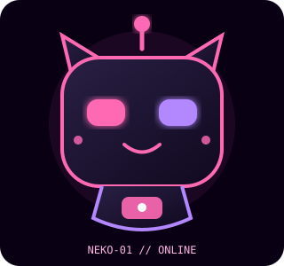

<!-- ===================================== -->
<!-- MUHAMMAD IRFANSYAH - GITHUB PROFILE   -->
<!-- CYBERPUNK NEON PINK & PURPLE          -->
<!-- ===================================== -->

<!-- HEADER -->

  

<!-- ANIMATED INTRODUCTION -->

  

---

<!-- ABOUT ME -->

<h2 align="center">💗 ABOUT ME 💗</h2>

  Hello! I'm <b>Muhammad Irfansyah</b>.
    
  🎓 Informatics Engineering Student
   
  💻 Learning Web Development
   
  🎮 Interested in Game Development
   
  🌌 Exploring Creative Ideas
   
  🚀 Building Personal Projects
   
  🌱 Learning New Technologies

---

<!-- CODING WORLD -->

<h2 align="center">👨🏻‍💻 MY CODING WORLD</h2>

  

  <i>Every line of code is another step forward.</i>

---

<!-- TECHNOLOGIES -->

<h2 align="center">⚡ TECHNOLOGIES & TOOLS ⚡</h2>

  

  
  
  
  

---

<!-- CYBER ROBOT -->

<h2 align="center">🐱 MY CYBER ROBOT 🐱</h2>

  

  <b>NEKO-01 // SYSTEM ONLINE</b>
   
  <i>Your friendly cyber companion 💗</i>

---

<!-- GITHUB STATISTICS -->

<h2 align="center">📊 GITHUB STATISTICS</h2>

  
  

---

<!-- PROJECTS -->

<h2 align="center">🚀 MY PROJECTS</h2>

<table align="center">
  <tr>
    <td align="center" width="50%">
      <h3>💗 Gabriela Cinta</h3>
      
Romantic creative project.

      <a href="https://github.com/IRFANSYAH0705/gabriela-cinta">
        View Repository
      </a>
    </td>
    <td align="center" width="50%">
      <h3>🌸 Gabriela Flower</h3>
      
Flower-themed creative project.

      <a href="https://github.com/IRFANSYAH0705/gabriela-flower">
        View Repository
      </a>
    </td>
  </tr>
  <tr>
    <td align="center" width="50%">
      <h3>💌 Surat Romantis</h3>
      
Romantic letter website.

      <a href="https://github.com/IRFANSYAH0705/surat-romantis">
        View Repository
      </a>
    </td>
    <td align="center" width="50%">
      <h3>🌌 Velvet Galaxy</h3>
      
Creative website project.

      <a href="https://github.com/IRFANSYAH0705/velvet-galaxy">
        View Repository
      </a>
    </td>
  </tr>
</table>

  <b>🎮 CURRENT GAME PROJECT</b>
   
  <i>Velqorune — A pixel-art RPG adventure project.</i>

---

<!-- CONTRIBUTION SNAKE -->

<h2 align="center">🐍 CONTRIBUTION SNAKE 🐍</h2>

  

---

<!-- FOOTER -->

  

<h3 align="center">💜 CODE • CREATE • INNOVATE 💜</h3>

  <i>Designed by Muhammad Irfansyah</i>
    
  Thanks for visiting my profile! ✨

