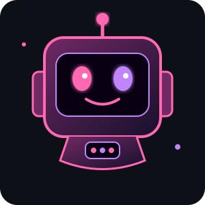

<!-- HEADER -->

  

<!-- ANIMASI TULISAN -->

  

<!-- ROBOT -->
<h2 align="center">🤖 MY ROBOT COMPANION</h2>

  

  

---

## 👨‍💻 ABOUT ME

- 👋 My name is Muhammad Irfansyah.
- 🎓 Informatics Engineering Student.
- 💻 Learning HTML, CSS, and JavaScript.
- 🎮 Interested in game development.
- 🌱 Always learning new things.
- 💗 Creating personal web projects.

---

## ⚡ TECHNOLOGY ARSENAL

  

---

## 📊 GITHUB COMMAND CENTER

  

  

---

## 🚀 MY PROJECTS

  <a href="https://github.com/IRFANSYAH0705/gabriela-cinta">
    🌹 Gabriela Cinta
  </a>
  &nbsp; • &nbsp;
  <a href="https://github.com/IRFANSYAH0705/gabriela-flower">
    🌷 Gabriela Flower
  </a>
    
  <a href="https://github.com/IRFANSYAH0705/surat-romantis">
    💌 Surat Romantis
  </a>
  &nbsp; • &nbsp;
  <a href="https://github.com/IRFANSYAH0705/velvet-galaxy">
    🌌 Velvet Galaxy
  </a>

---

## 💜 DEVELOPER STATUS

  

  <b>CODE • CREATE • INNOVATE</b>
   
  <i>Designed by Muhammad Irfansyah 💗</i>

  

